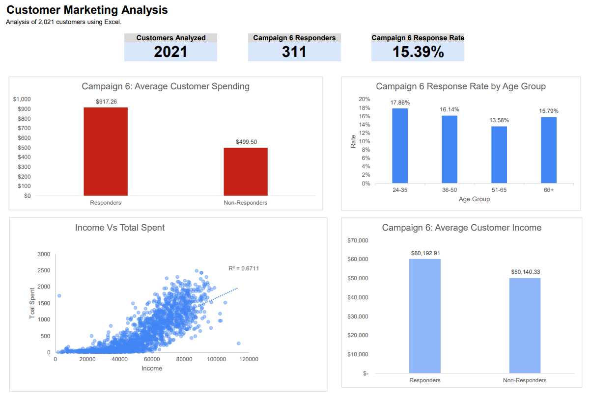

# Customer Marketing Analysis | Excel

## Project Overview

Analyzed **2,021 customer records** using Microsoft Excel to explore customer spending patterns, marketing campaign responses, and opportunities for better marketing decisions.

The analysis focuses on Campaign 6, comparing customers who responded with those who did not.

**Tools:** Microsoft Excel, PivotTables, XLOOKUP, COUNTIF, AVERAGEIF, SUMIF, IFS, and data visualization.

## Dashboard

## Key Findings

- **15.39% response rate:** 311 out of 2,021 customers responded to Campaign 6.
- **84% higher spending:** Responders spent an average of $917.26, compared with $499.50 for non-responders.
- **Highest response rate by age:** Customers aged 24–35 had the highest response rate at 17.86%.
- **Higher average income:** Responders earned approximately 20% more than non-responders.
- **Income and spending relationship:** The scatter plot showed a positive relationship, with an R² of 0.6711.

## Business Recommendations

1. Test targeted marketing campaigns for customers aged 24–35.
2. Consider customer spending history when segmenting audiences.
3. Compare campaign performance across customer groups before making targeting decisions.

## What I Learned

This project strengthened my ability to use Excel to analyze customer data, build PivotTables and charts, compare customer groups, and communicate findings.

One important lesson was recognizing how filters can affect analysis results and ensuring that comparisons use the correct customer population.

## Project Files

- **DoorDash_Case_Study.xlsx:** Excel workbook with customer data, analysis, dashboard, and lookup tool.
- **dashboard.png:** Screenshot of the Excel dashboard.

*Dataset: Public customer marketing data. DoorDash was used as a business scenario; this project is not affiliated with DoorDash.*
